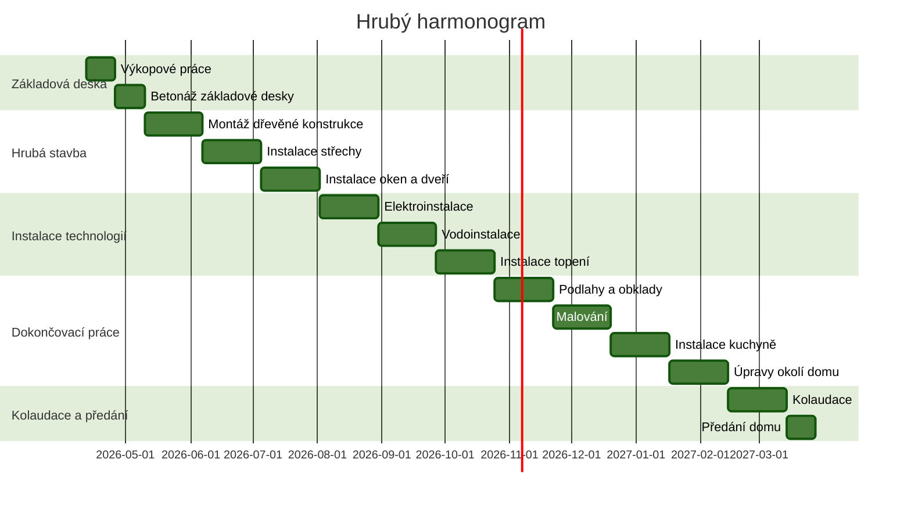
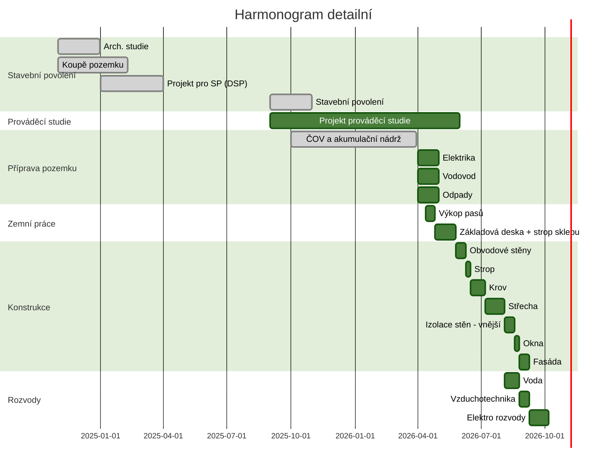

# Harmonogram

---

- zemní a výkopové práce (zemní a terénní úpravy, výkopy základů a základových spár, přemístění stržené ornice a uložení
  či odvoz hlušiny)
- budování základů domu (včetně hydroizolací a případné ochrany před zvýšeným radonovým rizikem a prostupů inženýrských
  sítí)
- hrubá spodní stavba (realizace svislých a vodorovných konstrukcí přízemí, vodorovné izolace a případně i zásypy a
  obsypy)
- realizace střechy (střešní konstrukce i krytina včetně doplňků, střechy se rovnou realizují kompletní s výjimkou
  odvádění vody, okapové systémy realizujeme až po případném vnějším zateplení a realizaci fasády)
- realizace nezděných nenosných příček a dalších konstrukcí (třeba sádrokartonové podhledy, příčky včetně osazení
  zárubněmi, …)
- realizace hrubých instalací (rozvody vody, kanalizace, elektřiny, plynu, vzduchotechniky, ústředního topení včetně
  podlahového vytápění – s ním souvisí i podkladové vrstvy podlah, …)
- realizace vnitřních omítek
- realizace podlah a obkladů
- vnitřní malířské a natěračské práce, nášlapné vrstvy podlah, kompletace instalací
- realizace fasády (případně i zateplení fasády a dokončovací klempířské práce – parapety, okapy, …)
- dokončovací práce (venkovní schodiště, chodníky, …)
- kontrola kvality a odevzdání stavby
- úprava terénu a realizace zahrady včetně oplocení včetně bran a branek (pokud nebylo oplocení realizováno již dříve)

---

- Příprava povolení a sítí (Podzim 2025 - Březen 2026) [hotovo]
    - Září-listopad 2025: Stavební povolení
    - Říjen 2025 - březen 2026: Osazení ČOV a akumulační nádrže
- Zemní práce a základy (Duben - Květen 2026)
    - Týden 1-2 (od 12. 4. 2026): Výkop základových pasů
    - Týden 3-6: Základová deska + strop sklepu
- Hrubá konstrukce (Květen - Září 2026)
    - Týden 7-8: Obvodové stěny
    - Týden 9: Strop
    - Týden 10-12: Krov
    - Týden 13-16: Střecha
    - Týden 17-18: Vnější izolace stěn
    - Týden 19: Okna
    - Týden 20-21: Fasáda
- Rozvody (Srpen - Říjen 2026)
    - Týden 17-19: Voda
    - Týden 20-21: Vzduchotechnika
    - Týden 22-25: Elektro rozvody
- Dokončovací práce (Říjen 2026 - Únor 2027)
    - Týden 26-31: Vnitřní omítky, podhledy
    - Týden 32-37: Podlahy a obklady
    - Týden 38-41: Malování a finální úpravy interiéru
    - Týden 42-45: Instalace kuchyně a koupelny
    - Týden 46-48: Úpravy okolí domu (stání, chodník, zarovnání terénu)
- Kolaudace a předání (Březen - Duben 2027)
    - Týden 49-52: Kolaudace a předání domu
